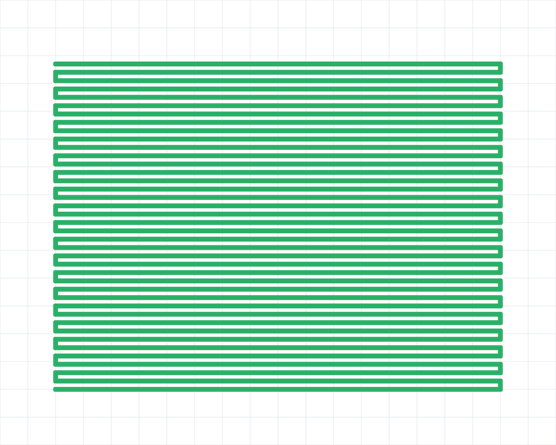

# 首页全程几何轨迹与资源对照

2026-10-26，APP本地实现和合成基准。首页实际执行轨迹从“最近500个位姿+逐边/逐采样圆绘制”改为连续几何带；规划路径仍使用已有完整缓存路径。

## 行为

- 保留本次APP接收过程从起点至当前的轨迹，不按时间或总点数淘汰。直行/近直行使用最大1厘米的绝对几何误差合并，保留转弯、回头和颜色变化；不是简单删掉早期点或加大原500上限。
- 以原有0.9米磨盘宽度画连续圆角Path；颜色沿用研磨遍次，较新遍次的形状在交叉处覆盖较早遍次。初始/孤立位置画单个轮廓，不再给每个采样点画圆。图形是执行轨迹示意，不作为磨盘实际使能或已研磨面积判据。
- 分块上限128只是单块容量，没有总量128/500限制。完成块不可变并复用，只有当前小块更新；机器人最新位置/朝向单独保存。手势用矩阵处理，重复缩放/平移不逐点投影。
- 暂停保留；换任务、空闲/显式停止沿用原清理规则。READY只更新小车，不记录执行带。断线、超过3秒没有上报、无效/越界位置留断口，不补画未观测到的行走。
- 几何参数未读取时先保存有效位姿，参数到齐后转换；已记录部分保留当时校准，参数变化从新段开始。APP退出/重启后的旧轨迹未新增回放补取，离线未收到的数据不能保证补全。

## 测量结果

输入为40行往复合成路线，5万个采样点；新几何80顶点、1个绘制Path，旧产品只保留最后500个位姿。以下每组预热5次，21次交替测量，中位数：

| 测量 | 旧版最近500点 | 新版保留全程 | 变化 |
| --- | ---: | ---: | ---: |
| 开发机整批5万条位姿更新 | 140.9224 ms | 6.2252 ms | 降低95.58% |
| 上述更新累计托管分配 | 289.63 MiB | 20.60 MiB | 降低92.89% |
| Android缓存命中后离屏手势重绘 | 2.5916 ms | 1.4482 ms | 降低44.12% |

该示例旧版每次绘图999个线/圆调用，新版1个Path。历史轨迹数值字段载荷从旧500个位姿约8000字节变为640字节XY（另保留1条当前小车位姿与元数据）。这不是完整进程内存/峰值RAM测量，也未测原生Path缓冲占用。

同覆盖范围的对照也保留：将原逐边逐点画法用于全部5万点，缓存命中后离屏绘制为253.7292ms，新版为1.4482ms。`old_full`是同覆盖范围的原画法对照，旧产品本身不会保留5万点。

不能把开发机数据更新耗时与Android离屏绘图相加，也不能换算为实机FPS/整页响应速度。模拟器只运行独立库测试，未启动生产机器人页面或连接机器人。

## 适用边界

所有收到的有效路段参与构建，最终形状按1厘米容差近似，不会逐条永久保存原始上报。长曲线和大量转弯仍会增加几何复杂度与内存，不能保证任意完整路线都比旧版被截断的500点占用更小。合成往复路线展示的是常见直线密集路径的收益，不代表所有地图和设备。压缩仅用于显示，不改变任务规划、下发路径或运动指令。

## 图与数据

下图是原生代码离屏输出的合成轨迹，非现场UI截图。原500点只剩最后一小段；新版显示全程。

旧版：

新版：

`jvm-update-raw.csv`126行、`android-render-raw.csv`378行，共504条有效数据；`summary.csv`包含全部24组中位数/P95。
`environment-and-sources.json`记录环境、源文件和APK哈希。数据包包含当前实现、基准源码及冻结旧版两个源文件。

下载：[全程几何轨迹数据包.zip](全程几何轨迹数据包.zip)。

## 验证与复跑

设备模块64项常规测试通过，另1项选择性性能测试在基准运行中通过。14项轨迹状态测试包含10万采样直线保留起终点、5000非共线转弯全部保留、1厘米全样本误差检查、分块不可变、颜色、回头、缺失位置和晚到参数。4项Android原生测试通过，覆盖全程起点、重绘缓存、越界断口、交叉颜色、0/30/-45度及缩放平移的像素对照。生产APK及测试包打包成功。

JVM复跑：设置环境变量`ROBOT_TRAJECTORY_BENCHMARK=1`和`ROBOT_TRAJECTORY_BENCHMARK_OUTPUT=输出绝对目录`，运行`:feature:device:testDevDebugUnitTest --tests '*TaskTrajectoryPerformanceBenchmarkTest'`并使用`--init-script scripts/path-performance/benchmark.init.gradle`。
Android复跑：构建/安装`:feature:device:assembleDevDebugAndroidTest`，对测试包`com.sinelynx.grindingrobot.feature.device.test/androidx.test.runner.AndroidJUnitRunner`运行类`TaskTrajectoryRenderBenchmarkTest`，传`-e robotTrajectoryBenchmark true`；原始输出在测试包外部目录`files/trajectory-performance`。
测试临时MuMu实例已核对创建身份并删除，原实例0保留；没有部署到平板或操作现场机器人。
